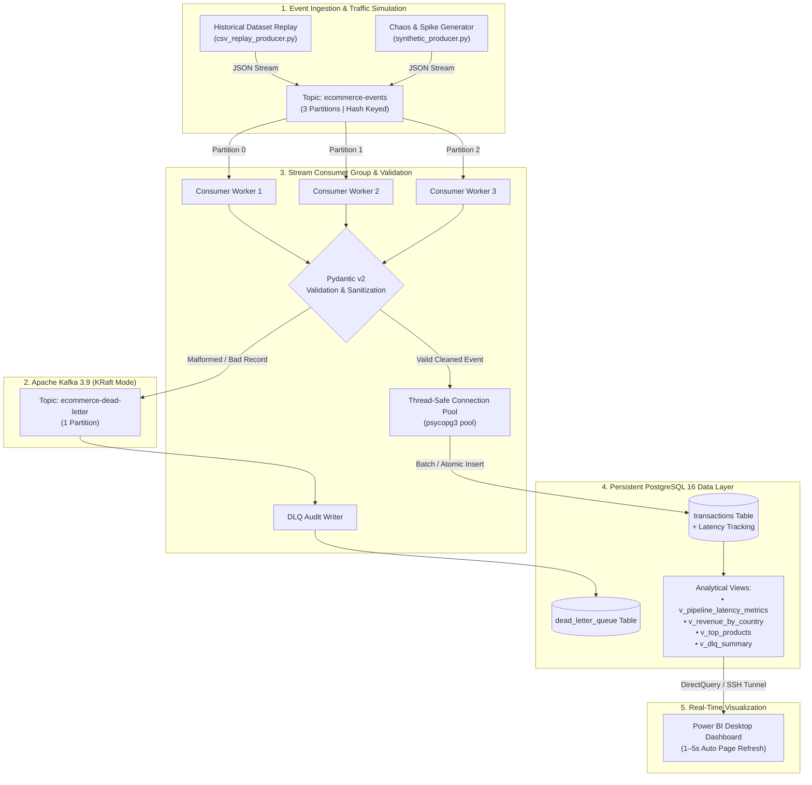

# ⚡ Real-Time E-Commerce Streaming Analytics Pipeline

> **A production-grade, event-driven data engineering pipeline with sub-15ms end-to-end latency.**  
> Ingests high-velocity e-commerce transactions through Apache Kafka (KRaft), validates and cleanses payloads on-the-fly via Pydantic v2 with Dead-Letter Queue (DLQ) routing, scales across horizontal consumer groups, persists into PostgreSQL 16 with pre-computed analytical views, and serves live streaming dashboards in Power BI via DirectQuery.

---

## 🌟 Key Engineering Highlights

- **⚡ Sub-15ms End-to-End Processing Latency**:  
  Tracks nanosecond/millisecond propagation latency from producer timestamp (`produced_at`) to database commit (`processed_at`). Computes live **p50 (13.5ms), p95 (25.8ms), and p99 (29.8ms)** latency percentiles directly via PostgreSQL `PERCENTILE_CONT`.
- **🛡️ High-Throughput Schema Validation & Cleansing (Pydantic v2)**:  
  Enforces strict types, auto-imputes missing descriptions, normalizes guest checkout customer IDs, computes derived order valuations, and classifies purchases vs. returns in sub-millisecond compiled C/Rust speed.
- **🚨 Zero Data-Loss Dead-Letter Queue (DLQ)**:  
  Corrupted JSON, negative unit prices, and malformed payloads are isolated and routed to a dedicated `ecommerce-dead-letter` topic and `dead_letter_queue` audit table without crashing the consumer stream.
- **🔄 Parallel Consumer Scaling & Partition Rebalancing**:  
  Kafka topic partitioned into 3 parallel lanes. Consumer workers join a coordinated consumer group (`ecommerce-stream-group`) with dynamic rebalance callbacks, ensuring even workload distribution and zero duplicate reads via manual offset commits (`enable.auto.commit=False`).
- **📊 Real-Time DirectQuery Power BI Dashboard**:  
  Two-page executive and engineering dashboard (Business Overview & Pipeline Health SLA) updating via DirectQuery with **1–5 second Automatic Page Refresh (APR)**.
- **🐳 Multi-Container Production Orchestration & OCI Ready**:  
  Fully containerized via `docker-compose.prod.yml` with KRaft Kafka (no ZooKeeper dependency), automated topic provisioning, healthchecked PostgreSQL with persistent volumes, and auto-scaling consumer workers.

---

## 🏗️ Architecture & Data Flow



---

## 🛠️ Technology Stack

| Layer | Technology | Purpose & Implementation Details |
| :--- | :--- | :--- |
| **Message Broker** | Apache Kafka 3.9.0 (KRaft) | High-throughput distributed event streaming with 3 partitions; no ZooKeeper overhead. |
| **Stream Processing** | Python 3.12, `confluent-kafka` | Event deserialization, manual commit offsets, rebalance listeners, and connection pooling. |
| **Schema Validation** | Pydantic v2 | Rust-powered schema validation, data cleansing, and DLQ payload wrapping. |
| **Database** | PostgreSQL 16 (Alpine) | ACID relational persistence with custom indexes, UUID primary keys, and analytic views. |
| **DB Driver / Pool** | `psycopg` v3 + `psycopg-pool` | High-performance asynchronous connection pooling with binary protocol optimizations. |
| **Orchestration** | Docker & Docker Compose | Multi-container setup for broker, database, initializer, 3x consumers, and traffic generator. |
| **Visualization** | Microsoft Power BI (DirectQuery) | 2-page live dashboard (Executive Business KPIs & Data Engineering Pipeline SLA). |

---

## 📊 Live Latency & Performance Benchmarks

Sample metrics recorded under sustained 35 events/sec synthetic chaos ingestion:

| Metric | Measured Value | Meaning / SLA |
| :--- | :--- | :--- |
| **Total Processed** | 2,100+ events | Real-time validated e-commerce transactions |
| **Average Latency** | **15.12 ms** | Mean end-to-end delivery time (Producer → Kafka → DB) |
| **p50 Latency (Median)**| **13.57 ms** | 50% of all events committed to disk under 14ms |
| **p95 Latency** | **25.85 ms** | 95% of events processed under 26ms |
| **p99 Latency** | **29.84 ms** | 99% of events processed under 30ms (tight tail latency) |
| **DLQ Isolation** | 84 rejected records | 100% of malformed events caught without pipeline interruption |

---

## 🚀 Quick Start (Local Development)

### 1. Clone & Environment Setup
```powershell
git clone https://github.com/Priyansh-hehe/realtime-ecommerce-analytics.git
cd realtime-ecommerce-analytics

# Create and activate Python 3.12 virtual environment
py -3.12 -m venv .venv
.\.venv\Scripts\Activate.ps1
pip install -r requirements.txt

# Copy environment template
cp .env.example .env
```

### 2. Launch Multi-Terminal Execution

#### 🖥️ Terminal 1 — Infrastructure (Start Containers)
```powershell
docker compose up -d
docker ps
```

#### 🖥️ Terminal 2 — Stream Consumer (Processing Engine)
```powershell
.\.venv\Scripts\Activate.ps1
python src/consumer/stream_consumer.py
```

#### 🖥️ Terminal 3 — Producer (Simulate Real-Time Traffic)
```powershell
.\.venv\Scripts\Activate.ps1

# Normal clean traffic (200 events at 30/s)
python src/producer/synthetic_producer.py --scenario NORMAL --rate 30 --max-events 200

# Or Chaos testing (negative prices, missing fields, corrupted JSON)
python src/producer/synthetic_producer.py --scenario CHAOS --rate 35 --max-events 300
```

#### 🖥️ Terminal 4 — Verify PostgreSQL Analytics Live
```powershell
# Inspect latency percentiles and processed count
docker exec -i postgres-ecommerce psql -U ecom_user -d ecommerce -c "SELECT * FROM v_pipeline_latency_metrics;"
```

---

## 📈 Power BI Dashboard (DirectQuery)

The Power BI report (`.pbix`) connects directly to `localhost:5432` (`ecommerce`) in **DirectQuery** mode with **Automatic Page Refresh (1–5s)** enabled:

- **Page 1 — E-Commerce Overview:** Total Revenue, Total Orders, Average Order Value (AOV), P95 Latency SLA, Revenue by Country, Top Products, and Country/Event Slicers.
- **Page 2 — Pipeline Health & SLA:** Events Processed, Avg/P95/P99 Latency cards, Ingestion Rate over time, Latency Distribution, and Dead-Letter Queue (DLQ) Audit table.

---

## 📂 Repository Structure

```text
realtime-ecommerce-analytics/
├── Dockerfile.consumer         # Container build definition for consumer worker
├── Dockerfile.producer         # Container build definition for traffic generator
├── docker-compose.yml          # Local development stack (Kafka + PostgreSQL)
├── docker-compose.prod.yml     # Production cluster (Broker, Init, Postgres, 3x Consumers, Producer)
├── commands.md                 # Complete CLI & operational command reference manual
├── requirements.txt            # Locked Python dependencies
├── .env.example                # Configuration template for credentials & topic names
└── src/
    ├── consumer/
    │   ├── basic_consumer.py   # Minimal prototype consumer
    │   └── stream_consumer.py  # Production consumer with Pydantic v2 & DLQ routing
    ├── producer/
    │   ├── basic_producer.py   # Baseline single-event producer
    │   ├── csv_replay_producer.py # Historical dataset streaming replay
    │   ├── synthetic_producer.py  # Chaos, Normal, & Spike traffic generator
    │   └── profiler.py         # Offline exploratory data profiling tool
    ├── sql/
    │   ├── schema.sql          # Table definitions, ENUMs, indexes, & analytical views
    │   └── analytics.sql       # Complex verification & reporting queries
    └── utils/
        ├── __init__.py
        └── db.py               # Thread-safe psycopg3 connection pool & insert helpers
```

---

## 🛡️ License
This project is open-source and available under the [MIT License](LICENSE).
